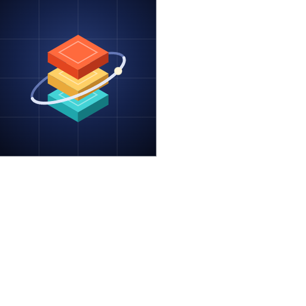
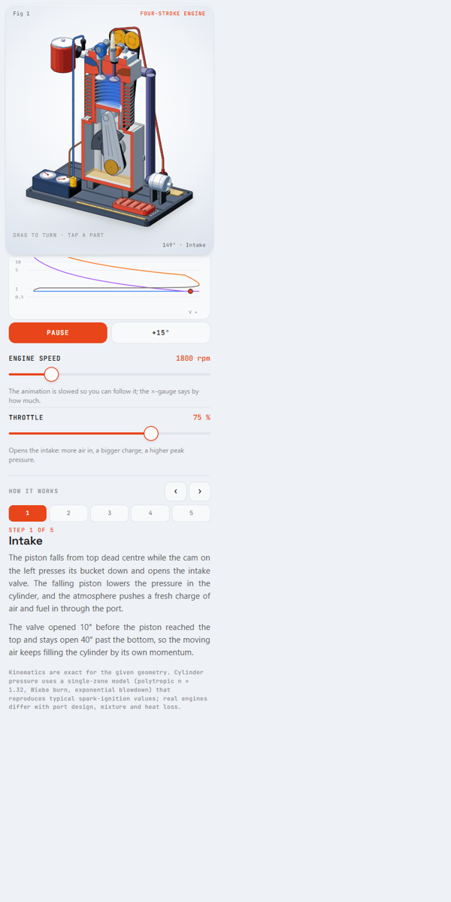
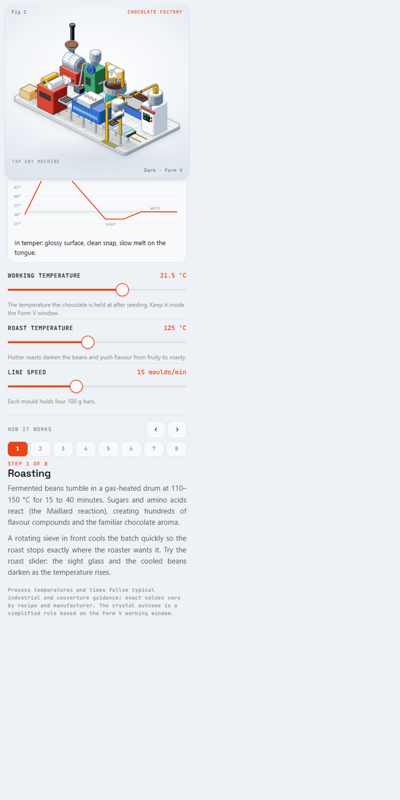
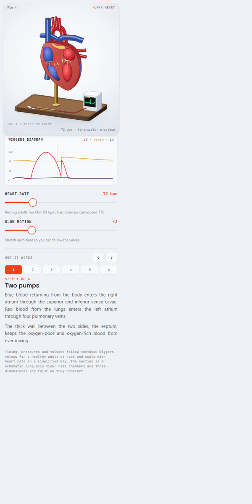
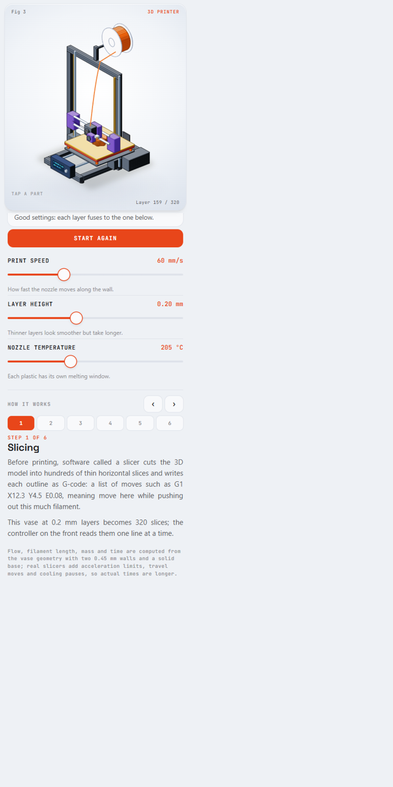

<p align="center"></p>

<h1 align="center">Anatomy Lab: How Things Work</h1>

<p align="center"><b>An interactive explorer of complex systems for Android.</b><br>
Engines, hearts, factories and machines drawn as precise, full-colour isometric models you can run, pull apart and question — every number driven by a real physical model.</p>

<p align="center">




</p>

---

## What's inside

| System | Shelf | What you can do |
|---|---|---|
| **Four-Stroke Engine** | Engineering | Sectioned air-cooled DOHC single on a test bench. Turn the crank by hand, change rpm and throttle, X-ray or explode it. WebGL charge, flame front and exhaust in the chamber; live tachometer and cylinder-pressure gauge; p–V indicator diagram. Slider-crank kinematics, sin² valve lift, polytropic compression, Wiebe burn. |
| **Chocolate Factory** | Factories & Making | Full bean-to-bar line: drum roaster, winnower + cyclone, granite melanger, conche, tempering machine, depositor, cooling tunnel, flow wrapper. Dark / milk / white couverture with real Form V tempering windows; set the working temperature and watch bars bloom when it's wrong. |
| **3D Printer** | Factories & Making | Bed-slinger FDM printer printing a twisting six-lobed vase layer by layer. PLA / PETG / TPU windows, volumetric-flow limit, filament length and mass, print time. |
| **Human Heart** | Biology | Long-axis section on a stand. Chambers contract through the Wiggers cycle, four valves open and close, blood flows, live ECG; Electrical mode animates the conduction system. Pressures, volumes, stroke volume, cardiac output. |
| **Pin-Tumbler Lock** | Everyday | Sectioned brass cylinder: drag the key in and watch five pin stacks reach the shear line; try the wrong key. |
| **Orrery: Sun, Earth & Moon** | Space | Brass orrery with a fixed 23.44° tilt, Kepler orbit, date pointer, moon phases (2026), daylight hours and noon Sun height for any latitude. |
| **Electrolysis of Water** | Chemistry | Hofmann voltameter: H₂ and O₂ collect 2 : 1 by Faraday's law; brine mode makes chlorine; indicator colours at the electrodes; live ammeter and voltmeter. |
| **DC Electric Motor** | Physics | Field magnets, armature, split-ring commutator and brushes; Lorentz-force arrows and moving charges; speed, current, back-EMF, torque and efficiency from the motor equations. |
| **Hard Disk Drive** | Technology | Lid-off drive: platters spin, the voice-coil arm seeks with a bang-bang profile, then waits for the sector to rotate under the head; seek time, latency and data rate. |
| **The Water Cycle** | Nature | Island diorama with a cut-away aquifer: Clausius–Clapeyron evaporation, wind-driven clouds, orographic rain, snowline from the lapse rate, river and groundwater return. |
| **Coin Mint** | Factories & Making | Coil → blanking press → rimming mill → annealing furnace → washing drum → coining press → counting bin. Set the striking force and alloy (nickel-brass, cupronickel, bimetal); a live coin shows how much of the relief fills; pressure, die life, coins per hour. |
| **Bottling Plant** | Factories & Making | Rinser, 72-valve rotary filler, capper, labeler, inspection gate and case packer. Water / juice / cola; Torricelli valve flow against time under the valve; speed the line up until bottles leave half-full and get rejected. |
| **Injection Moulding Machine** | Factories & Making | Cut-away barrel and screw, heater bands, toggle clamp and a two-part mould making toy bricks. ABS / PP / PC; melt temperature, injection speed and cooling time decide between good parts, short shots, flash, burns and warping. |
| **Mechanical Watch** | Engineering | Mainspring barrel, gear train, Swiss lever escapement, balance wheel and hairspring at 28,800 bph. Slow motion, wind and regulator; amplitude, rate in s/day, power reserve. Escapement mode zooms in on the lever. |
| **Jet Engine** | Engineering | Cut-away two-spool turbofan: fan, booster, HP compressor, annular combustor, turbines, exhaust cone; air coloured by temperature. Brayton-cycle thrust, EGT, fuel flow, OPR and TSFC from throttle and air speed. |
| **Rocket Launch** | Space | Cut-away two-stage rocket on its pad. Launch it: max-Q, gravity turn, staging, fairing separation and orbit, flown by a point-mass simulation with drag; payload decides whether it reaches orbit. |
| **Lungs & Breathing** | Biology | Trachea, bronchial tree, lobed lungs, diaphragm, ribs; an alveolus close-up with O₂ and CO₂ crossing. Breathing rate, breath size and altitude drive alveolar ventilation, the alveolar gas equation, SpO₂ and pH. |
| **Volcano** | Nature | Voxel stratovolcano cut through the summit: strata, conduit, dyke, sill and magma chamber. Silica and gas decide between Hawaiian, Strombolian, lava dome, Vulcanian and Plinian eruptions; plume height, eruption rate, VEI. |
| **Refrigerator** | Everyday | Side-cut fridge-freezer with condenser, compressor, capillary and evaporator; refrigerant coloured by state. Thermostat, kitchen temperature and door; duty cycle, COP, watts and kWh per day with a live thermostat trace. |
| **Oil Refinery** | Chemistry | Crude tank, fired furnace and a cut-away distillation column with trays, drawing gas, petrol, naphtha, kerosene, diesel, fuel oil and residue to their tanks. Light or heavy crude; yields from the boiling curve. |

Every lab has view modes, sliders, live gauges, a synced step-by-step explanation, **tap-any-part identification** (the part glows and its name and job appear) and **zoom**: pinch with two fingers, double-tap, or use the + / − buttons.

## App features

- Two splashes: animated Anatomy Lab mark (assembles from an exploded view), then the F7 Developer ident video.
- Interactive onboarding (four animated pages, theme choice).
- Home with featured carousel, "continue exploring", shelves per category; Explore (9 shelves), Search, Saved, Settings, About, Rate us, Share app.
- Light (default) and dark themes, chosen in onboarding or Settings.
- Offline-first: every lab is bundled; nothing is downloaded at runtime.
- AdMob banner (in its own reserved row, never over content), interstitial only when leaving a lab after real use (≥ 40 s, ≥ 3 min apart, never the first lab), rewarded video only when the user chooses it to unlock poster sharing.
- Google UMP consent before any ad request; Privacy options entry when required.
- **Remove Ads — $4.99** one-time in-app product (`anatomylab_remove_ads`) with restore purchases.
- "Share as poster": captures the live figure (WebGL included) with PixelCopy, frames it and shares it.

## Architecture

```
figures/                 Node build pipeline for the labs (no npm dependencies)
  vendor/anatomy/        The Anatomy kit (MIT, github.com/wheresryan22/anatomy) — iso camera, solids,
                         lathe & tube parts, WebGL layer, capture tools
  lab/shell.mjs          The lab page shell: controls, modes, gauges, steps, part picker, Android bridge
  lab/materials.mjs      Full-colour material system layered on the kit's four-tone shading
  lab/inline.mjs         Inlines kit modules into a standalone page
  systems/<id>/          One folder per system: model.mjs (pure physics), build.mjs (geometry + live code),
                         content.json (texts, controls, steps, parts, facts, sources)
  build-all.mjs          Builds every system (light + dark) into app/src/main/assets/labs and writes catalog.json
  thumbs.mjs             Captures transparent thumbnails of each figure with headless Chrome
app/                     Android app (Kotlin, Jetpack Compose, Material 3)
  ui/                    Splashes, onboarding, home, explore, search, saved, settings, lab screen
  ads/ billing/          AdMob + UMP, Google Play Billing 8
  data/                  Catalog repository, DataStore preferences
tools/                   Icon generator, thumbnail converter
marketing/               Icon, store listing text, screenshots
docs/                    Privacy policy (GitHub Pages)
```

Each lab is a self-contained HTML page rendered in a WebView served from the APK through
`WebViewAssetLoader`. The native app talks to it through a small bridge (`window.Lab` in the
page, `AnatomyNative` in the app): readiness, step changes and part picks (haptic feedback),
and pause/resume with the activity lifecycle.

### Adding a system

1. `mkdir figures/systems/my-system` with `model.mjs`, `build.mjs` (export `WIDTH`, `HEIGHT`, `figure(theme)`) and `content.json` (copy an existing one).
2. `cd figures && node build-all.mjs my-system && node thumbs.mjs my-system && python ../tools/webp_thumbs.py`
3. Rebuild the app. The catalog, search, shelves and thumbnails pick it up automatically.

## Build

Requirements: JDK 17+, Android SDK 36, Node 20.10+, Chrome (for thumbnails), Python 3 with Pillow.

```bash
cd figures && node build-all.mjs && node thumbs.mjs && python ../tools/webp_thumbs.py && cd ..
./gradlew assembleDebug
```

Release (needs `keystore.properties` + the keystore, both git-ignored):

```bash
./gradlew bundleRelease assembleRelease
```

### Ads and billing configuration

Without configuration the app uses Google's public **test** ad units. For production create
`admob.properties` (git-ignored) in the project root:

```properties
admobAppId=ca-app-pub-XXXXXXXXXXXXXXXX~YYYYYYYYYY
bannerUnitId=ca-app-pub-XXXXXXXXXXXXXXXX/1111111111
interstitialUnitId=ca-app-pub-XXXXXXXXXXXXXXXX/2222222222
rewardedUnitId=ca-app-pub-XXXXXXXXXXXXXXXX/3333333333
```

In Play Console create a one-time in-app product with ID `anatomylab_remove_ads` priced at
USD 4.99, and set up the GDPR/US-states messages in AdMob → Privacy & messaging.

## Content rules

All art avoids lifelike faces; there is no background music (sound effects and the brand
sting only). Every system lists its modelling assumptions and references in its info sheet.

## Credits & licences

- Figure engine: [Anatomy](https://github.com/wheresryan22/anatomy) by Ryan — MIT licence (`figures/vendor/anatomy/LICENSE`).
- Typefaces: Space Grotesk and JetBrains Mono — SIL Open Font Licence 1.1.
- App code, art direction, models and texts © F7 Developer. All rights reserved.
